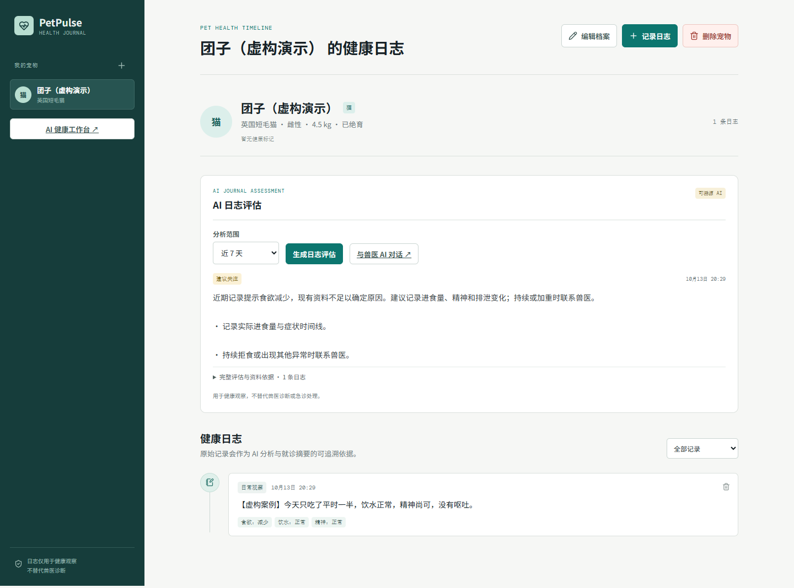
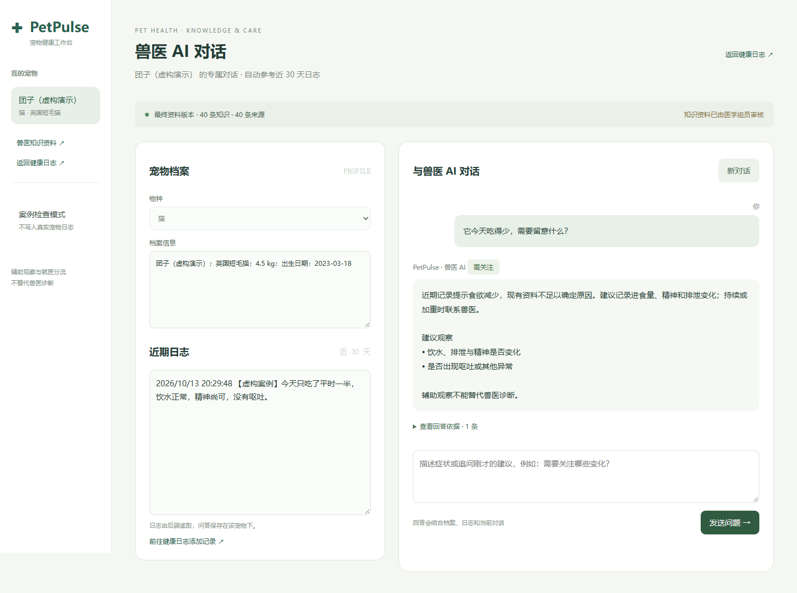
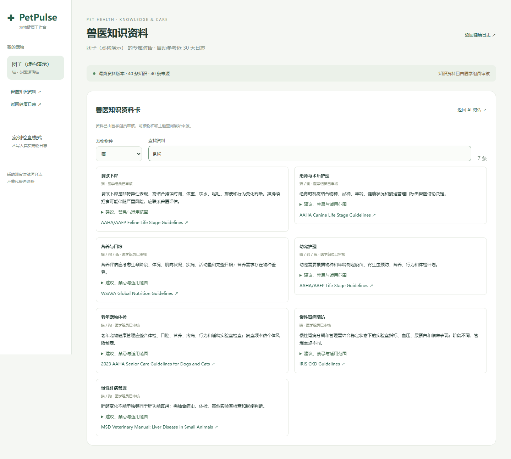

# PetPulse · 宠物健康日志与兽医 AI

把日常观察变成可追溯的健康建议。PetPulse 将宠物档案、健康日志和兽医知识检索连接起来，支持日志评估、连续问答和来源回溯。

> 面向本地开发与演示的全栈项目。辅助健康观察和就医沟通，不能替代兽医诊断、处方或急诊处理。当前没有用户认证，不应直接暴露到公网。

## 功能

- **宠物专属记录**：支持猫、犬和兔，记录体重、过敏、既往史、用药，以及按时间排列的健康日志。
- **AI 日志评估**：分析近 7 / 14 / 30 天记录，显示健康变化和下一步建议；完整分析与依据可展开。
- **连续 AI 对话**：左侧档案与近期日志，右侧聊天；历史对话保存至 PostgreSQL，支持追问和新会话。
- **独立资料页**：40 张知识卡、40 条来源，支持物种筛选、主题搜索和原始来源链接。
- **混合 RAG 检索**：3072 维向量、中文关键词与同义词融合排序，强制物种过滤，返回实际使用的证据。
- **输出约束**：结构化结果校验、保守风险分流、拒绝药物剂量，正文隐藏内部资料编号。
- **数据持久化**：Docker 命名卷保存档案、日志、报告和对话，后端重启不清空数据库。
- **双重确认删除**：先确认删除范围，再输入完整宠物名；后端校验短时确认凭据后执行级联删除。

项目使用外部 Chat / Embedding API 实现 RAG，未训练或微调基础模型。知识摘要已由项目医学组员审核；工程分流规则和评测案例仍需独立医学验证。

## 界面预览

以下截图使用虚构案例，不包含真实宠物记录。





## 技术栈

| 层级 | 技术 |
| --- | --- |
| 前端 | HTML、CSS、原生 JavaScript |
| 后端 | Python、FastAPI、Pydantic |
| 数据库 | PostgreSQL 16、pgvector、HNSW / halfvec |
| AI | 可配置的 Chat Completions 与 Embedding HTTP API |
| 测试 | unittest、Playwright、真实 API 案例回归 |
| 部署 | Docker Compose 数据库、Uvicorn 本地服务 |

## 本地启动

需要 Python 3.11+、Docker Compose；浏览器检查另需 Node.js。

### 1. 安装依赖

```bash
git clone https://github.com/Jimmyanovice/PetPulse.git
cd PetPulse
python -m venv .venv
```

Windows PowerShell：

```powershell
.\.venv\Scripts\Activate.ps1
Copy-Item .env.example .env
python -m pip install -r requirements.txt
```

macOS / Linux：

```bash
source .venv/bin/activate
cp .env.example .env
python -m pip install -r requirements.txt
```

### 2. 配置模型与数据库

编辑本地 `.env`，设置数据库密码、Chat 和 Embedding 服务地址、API key 与模型名称。项目默认配置示例采用 Gemini 系列兼容服务；可替换为支持相同接口的提供商。向量模型需返回 **3072 维**，更改向量维度需要同步修改数据库 schema。

API key 只由后端读取。`.env` 不提交到 Git。AI 调用需要自行配置服务，并可能产生费用。

### 3. 启动数据库并索引知识库

```bash
docker compose up -d db
python scripts/index_final_corpus.py
python -m uvicorn app.main:app --host 127.0.0.1 --port 8001
```

首次初始化数据库可能需要几秒，待容器健康后执行索引。仓库自带最终 JSON 摘要与审核记录，无需原始 Excel 即可启动；向量首次生成需要 Embedding API。

| 页面 | 地址 |
| --- | --- |
| 健康日志 | http://127.0.0.1:8001/ |
| 兽医 AI 对话 | http://127.0.0.1:8001/ai-lab |
| 知识资料 | http://127.0.0.1:8001/ai-lab?view=knowledge |
| API 文档 | http://127.0.0.1:8001/docs |

新数据库初始没有宠物记录，请在左侧创建档案。数据保存在 `ai_vector_lab_postgres_data` 命名卷；不要运行 `docker compose down -v`，它会删除数据库数据。

## 目录

```text
app/                 FastAPI、RAG 引擎、删除确认与前端
data/final/          最终知识摘要与版本审核记录
data/NOTICE.md       医学来源与第三方内容使用说明
docs/               RAG 契约说明与虚构案例截图
init/               数据库初始化 SQL
scripts/            索引、启动、备份与回归检查
tests/              无需 API 密钥的单元测试
.github/workflows/  持续集成
compose.yaml        持久化数据库
.env.example        配置模板
```

历次团队文档、旧资料、运行日志、原始工作簿和测试输出仅保留在本地归档或被忽略，不包含在公开仓库中。

## 验证

单元测试不依赖数据库或外部 API：

```bash
python -m unittest discover -s tests -v
```

浏览器检查：

```bash
npm ci
npx playwright install chromium
npm run test:ui
```

需要启动后端。可设置 `PLAYWRIGHT_CHANNEL=msedge` 使用本机 Edge。额外检查：`npm run test:chat` 调用真实模型并产生费用；`npm run test:deletion` 会新建并删除明确标记的临时测试宠物。

真实模型案例回归：

```bash
python scripts/evaluate_final_rag.py
```

工程回归用于检查检索、物种隔离、来源、输出约束和风险下限，不代表临床准确率。详见 [RAG 说明](docs/FINAL_RAG.md)。

## 集成与后续工作

`POST /api/ai/consult` 适合接入其他前后端，可传物种、问题、档案、日志与最近 8 条对话；返回结构化建议与资料证据。档案、日志、报告和聊天持久化接口见 API 文档。

尚需完善用户认证、权限隔离、部署配置、临床案例评测、资料章节定位及覆盖范围。当前的 `pet_id` 隔离是数据查询边界，不能替代用户授权。配置外部 AI 服务时，档案、日志和对话上下文会发送给对应服务商。

## 许可证与贡献

项目代码使用 [MIT](LICENSE)。兽医资料与第三方内容参见 [来源说明](data/NOTICE.md)，代码许可证不授予第三方材料的版权许可。

欢迎提交 Issue / Pull Request，详见 [贡献指南](CONTRIBUTING.md)。
